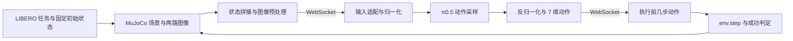

# 从 LIBERO 任务到 π0.5 动作的阅读路线

本指南对应本目录捕获的实际运行版本。先读一个 episode 的闭环，再读网络与训练，能较快对应“数据从哪里来、经过什么处理、动作如何执行”。

## 一条完整链路



模型服务和仿真进程通过 WebSocket 通信。它们使用不同 Python/依赖环境，阅读代码时要把“模型推理”和“仿真控制”这两个进程同时放在图里。

## 1. 先看评估主循环

入口：`openpi/examples/libero/main.py:48` 的 `eval_libero()`。

按照下面顺序阅读：

1. 通过 benchmark 名称建立任务集并取任务语言。
2. 从任务集读取固定初始状态，建立 `OffScreenRenderEnv`，设置 seed。
3. `reset()` 后设置选定初始状态，先执行 10 步稳定场景的空动作。
4. 读取 `agentview_image` 和 `robot0_eye_in_hand_image`；两幅图像旋转 180°，resize/pad 到 224×224。
5. 把末端位置、四元数转轴角、夹爪位置拼成 8 维 state，并带上任务语言。
6. 调用 `client.infer()` 取得动作序列，执行其中前 `replan_steps` 步。
7. 每步调用 `env.step()`，检查成功，继续获取新观察与重新规划。

这里先记住接口：

```python
observation = {
    "observation/image": ...,        # 主视角图像
    "observation/wrist_image": ...,  # 腕部图像
    "observation/state": ...,       # 8 维
    "prompt": ...,                  # 任务语言
}
actions = client.infer(observation)["actions"]
```

LIBERO 执行动作为 7 维：末端平移增量 3 维、旋转增量 3 维、夹爪命令 1 维。它们不是 Panda 七个关节的目标角度。

## 2. 看任务、场景和成功条件

| 文件或目录（均在 `openpi/third_party/libero/` 下） | 作用 |
| --- | --- |
| `libero/libero/benchmark/__init__.py:108` | benchmark 类；任务索引、任务对象、BDDL 路径和固定初始状态 |
| `libero/libero/benchmark/libero_suite_task_map.py` | 每套 benchmark 包含哪些任务 |
| `libero/libero/bddl_files/` | 任务语言、对象、初始谓词和目标谓词 |
| `libero/libero/init_files/` | benchmark 使用的固定初始状态 |
| `libero/libero/envs/env_wrapper.py:12` | `ControlEnv` 及其 step/reset/set_init_state 包装 |
| `libero/libero/envs/env_wrapper.py:152` | `OffScreenRenderEnv` |
| `libero/libero/envs/bddl_base_domain.py:37` | 由 BDDL 定义构建环境，继承 robosuite 的 `SingleArmEnv` |
| `libero/libero/envs/bddl_base_domain.py:779` | `_check_success()`，按目标谓词判断任务完成 |
| `libero/libero/envs/predicates/` | 任务目标用到的谓词实现 |
| `libero/libero/assets/` | 场景 XML、机器人和物体网格、纹理 |

跟踪 `env.step(action)` 时，会继续进入 **robosuite 1.4.1 的控制器**，再到 **MuJoCo 3.2.3**。这些是服务器仿真镜像的安装依赖。当前目录包含完整 LIBERO 源码及其资源；若进一步阅读 robosuite 底层，版本应对应 1.4.1，不能用其他示例项目的 1.5 系列代替该运行版本。

## 3. 看传输与策略封装

按调用顺序阅读：

```text
packages/openpi-client/src/openpi_client/websocket_client_policy.py
    → src/openpi/serving/websocket_policy_server.py
    → src/openpi/policies/policy.py:68  Policy.infer()
```

服务启动和模型构建入口：

```text
scripts/serve_policy.py:99  main()
    → training/config.py  get_config("pi05_libero")
    → policies/policy_config.py:16  create_trained_policy()
```

`create_trained_policy()` 决定加载哪个 checkpoint、哪套归一化统计，以及输入输出需要哪些变换。当前 checkpoint 是 JAX/Orbax 格式，代码根据权重文件格式选择 JAX 或 PyTorch 路线。

`Policy.infer()` 负责输入变换、增加 batch 维、调用 `model.sample_actions()`、移除 batch 维及输出变换。它是“外部机器人观察”与“内部模型张量”的连接点。

## 4. 看输入输出与数据变换

重点文件：

- `src/openpi/policies/libero_policy.py:30`：`LiberoInputs`。
- `src/openpi/policies/libero_policy.py:87`：`LiberoOutputs`，取回模型动作中的前 7 维。
- `src/openpi/transforms.py`：字段重排、归一化、图像与语言处理、维度 padding。
- `src/openpi/training/config.py:282`：`LeRobotLiberoDataConfig`，训练与推理共用的 LIBERO 适配规则。

模型内部配置默认的 action_dim 是 32，LIBERO 实际执行 7 维，适配层处理这个差异。数据集 state 是 8 维，映射规则、padding 与归一化统计应结合着读。

当前 `pi05_libero` 明确设置 `extra_delta_transform=False`。LIBERO 原数据动作已经是增量动作，重复做 delta/absolute 转换会改变动作含义。

## 5. 再看 π0.5 网络

这里没有独立名为 `pi05.py` 的 JAX 主模型：π0.5 通过 `Pi0Config(pi05=True)` 进入 `Pi0` 内部相应分支。

```text
training/config.py:744  pi05_libero
    → models/pi0_config.py:19  Pi0Config
    → models/pi0.py:66  Pi0
        → embed_prefix():106
        → embed_suffix():140
        → compute_loss():189
        → sample_actions():217
```

阅读时对照 `models/gemma.py`、`models/siglip.py` 和 `models/tokenizer.py`。先理解图像/语言 prefix、action expert 的 suffix、flow matching 的训练目标和动作生成，再展开每一层 attention。

`pi05_libero` 的配置是 `pi05=True, action_horizon=10, discrete_state_input=False`。状态输入的处理要结合这组具体参数与 `ModelTransformFactory` 一起看，不能直接把其他 π0.5 配置的默认行为套过来。

三个容易混淆的数字：

| 参数 | 当前官方示例/模型值 | 含义 |
| --- | ---:| --- |
| `action_horizon` | 10 | 一次预测多少个动作时间步 |
| `replan_steps` | 5 | 仿真实际执行几步后重新观察、重新调用策略；历史 smoke 用的是 10 |
| `sample_actions(num_steps)` | 默认 10 | 生成这一段动作时 flow matching 数值积分的步数 |

它们分别控制预测长度、闭环重规划间隔和一次生成的计算过程。

## 6. 最后看训练

```text
examples/libero/convert_libero_data_to_lerobot.py
    → 原始 HDF5 转 LeRobot（服务器已有转换后的数据，可直接阅读这一步）

training/config.py:744
    → pi05_libero 模型/数据/优化器/初始化权重配置

training/data_loader.py:130
    → LeRobotDatasetMetadata 与 LeRobotDataset
    → 动作序列 delta_timestamps
    → 字段映射及训练变换

scripts/compute_norm_stats.py
    → 计算所用训练数据的归一化统计

scripts/train.py:194  main()
    → 创建数据加载器、模型、初始化权重和优化器
    → train_step():137
    → model.compute_loss()
    → 更新参数、保存 checkpoint
```

官方基础权重初始化来自 `gs://openpi-assets/checkpoints/pi05_base/params`。checkpoint 中的归一化统计、训练数据版本和模型配置都属于实验材料。

## 建议的第一轮阅读目标

先任选一个任务，在代码中标清这六件事：任务语言从哪来、初始状态从哪来、图像为什么旋转、8 维状态怎么拼、7 维动作在哪里裁剪、成功条件在哪里计算。把这一轮闭环串起来后，再研究 `sample_actions()` 与 `compute_loss()`，会更容易把模型结构和机器人行为对应起来。
